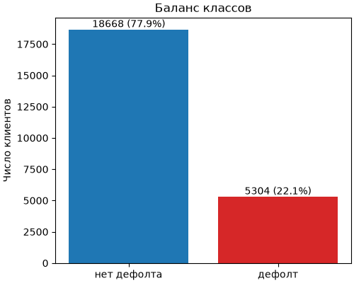
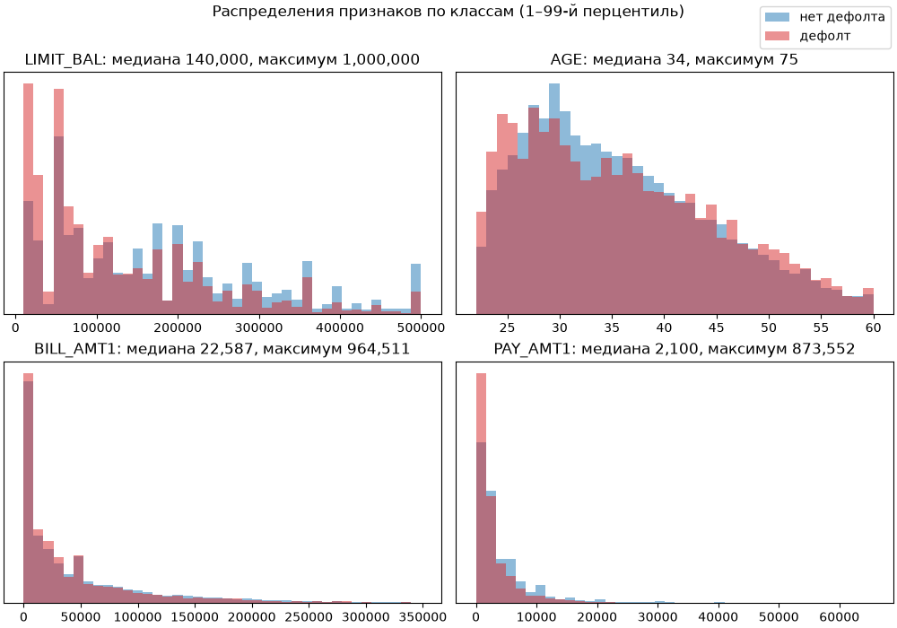
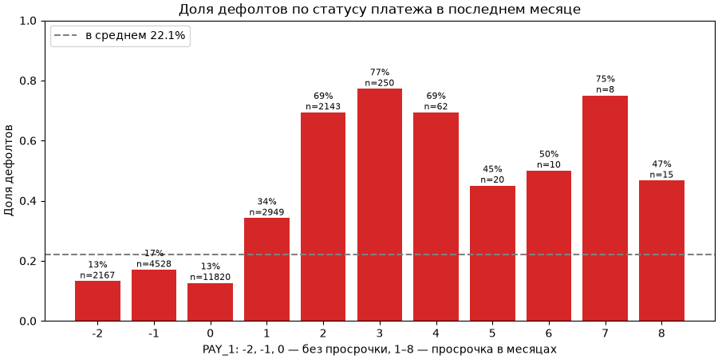

# Разведочный анализ данных

Анализ построен на обучающей выборке `data/processed/train.csv`: 23 972 клиента после очистки. Версия исходных данных: MD5 `940b416bb13a9b24bb5c9e1589284005`, тот же хэш записан в `data/raw/UCI_Credit_Card.csv.dvc`. Тестовая выборка в анализ не входит. Графики строит DVC-стадия `eda` (`src/credit_default/analysis/eda.py`), команда `dvc repro` пересоздаёт их при изменении данных или кода.

## Баланс классов

Дефолт допустили 5 304 клиента из 23 972, то есть 22,1 %. Классы несбалансированы: модель, которая всегда предсказывает отсутствие дефолта, получает accuracy 77,9 % и при этом бесполезна. Поэтому модель оценивается прежде всего по ROC-AUC: эта метрика не зависит от порога и от доли классов. Для класса «дефолт» дополнительно нужны precision, recall и F1. Разбиение на train и test уже стратифицировано по целевой переменной, кросс-валидацию тоже нужно стратифицировать.

## Распределения признаков

- **LIMIT_BAL** (кредитный лимит): медиана 140 000, максимум 1 000 000. У клиентов с дефолтом распределение смещено к малым лимитам: вероятно, банк выдаёт меньший лимит тем, кого считает рискованнее.
- **AGE**: медиана 34 года. Распределения классов близки, дефолты немного чаще среди самых молодых клиентов (до 27 лет) и среди клиентов старше 40. Зависимость слабая и немонотонная. В модели возраст остаётся числовым признаком: такую зависимость способен учесть случайный лес.
- **BILL_AMT1** (сумма счёта) и **PAY_AMT1** (сумма платежа): распределения с длинным правым хвостом. Максимум BILL_AMT1 равен 964 511 при медиане 22 587, максимум PAY_AMT1 равен 873 552 при медиане 2 100. У 460 клиентов (1,9 %) счёт отрицательный, то есть клиент переплатил, у 4 175 клиентов (17,4 %) платёж нулевой. Такие значения допустимы, поэтому строки с ними не удаляются. Абсолютные суммы зависят от лимита, поэтому информативнее доля использованного лимита (BILL_AMT1 / LIMIT_BAL). Деление безопасно: валидация данных проверяет, что LIMIT_BAL больше нуля. Перед линейной моделью признаки нужно масштабировать.

## Статус платежа PAY_1

PAY_1 — статус платежа в последнем месяце: −2, −1 и 0 означают отсутствие просрочки, 1–8 — просрочку на соответствующее число месяцев. Это самый сильный из рассмотренных признаков:

- при статусах −2, −1 и 0 доля дефолтов 13–17 %, ниже средней (22,1 %);
- при просрочке на 1 месяц доля дефолтов 34 %, на 2 месяца 69 %, на 3 месяца 77 %;
- статусы от 4 до 8 редки (от 8 до 62 клиентов), доли в них колеблются от 45 до 75 % и ненадёжны.

Коды −2, −1 и 0 по риску почти не различаются, а положительные значения упорядочены по силе просрочки. Отсюда признак по истории платежей: максимальная просрочка по PAY_1…PAY_6, в которой коды −2, −1 и 0 считаются нулём.

## Выводы для модели

| Вывод | Решение |
|---|---|
| Доля дефолтов 22,1 %, классы несбалансированы | основная метрика ROC-AUC; стратифицированные разбиение и кросс-валидация |
| Суммы счетов и платежей с длинным хвостом, зависят от лимита | признак LIMIT_UTILIZATION = BILL_AMT1 / LIMIT_BAL, масштабирование |
| Отрицательные счета и нулевые платежи встречаются регулярно | значения сохраняются; знаменатель LIMIT_BAL всегда больше нуля |
| Возраст влияет слабо и немонотонно | AGE остаётся числовым признаком |
| Просрочка в последнем месяце резко повышает риск | признак MAX_DELAY: максимальная просрочка по PAY_1…PAY_6 |
